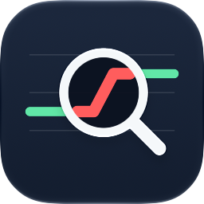
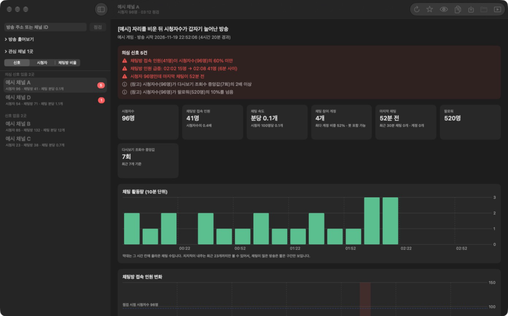
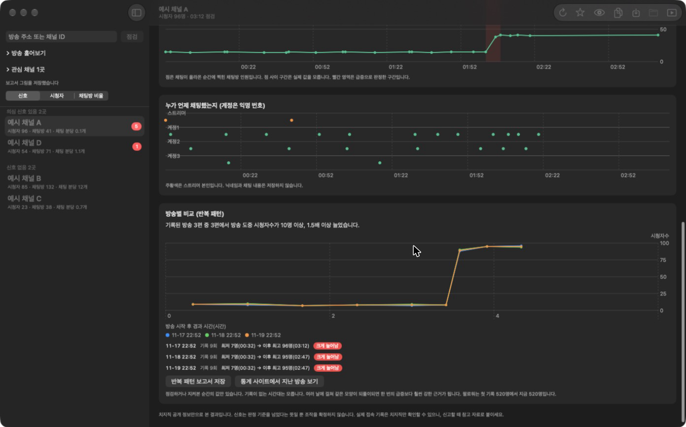

# 치지직 점검 (ChzzkCheck)

[](https://github.com/sudapeople/chzzk-check/releases/latest)
[](https://github.com/sudapeople/chzzk-check/releases/latest)
[](https://github.com/sudapeople/chzzk-check/releases)
[](LICENSE)<br>
[](#내려받기)
[](#빌드설치)
[](src/ChzzkCheck.swift)
[](#필요한-것)
[](#필요한-것)
<br>
[](https://github.com/sudapeople/chzzk-check/stargazers)
[](https://github.com/sudapeople/chzzk-check/forks)
[](https://hits.sh/github.com/sudapeople/chzzk-check/)
[](https://github.com/sudapeople/chzzk-check/commits/main)
[](https://github.com/sudapeople/chzzk-check/issues)
[](src)<br>
[](https://discord.gameboy.kr)
[](https://www.youtube.com/channel/UCcm7Jc50537eMixvkVNU8-Q)
[](https://chzzk.naver.com/bcf71dbdafcdddae524d82490db546c0)
[](https://www.instagram.com/sudapeople/)
[](https://x.com/sudapeople)

한국어 | [English](#english)

치지직 방송 주소를 넣으면 시청자수, 채팅방 접속 인원, 채팅 흐름을 한 번에 점검하고,
신고할 때 붙일 근거 자료(요약문, 원본 데이터, 방송 화면, 보고서 그림)를 남기는 맥 앱.

시청자수가 방송 내용과 맞지 않게 늘어난 방송을 봤을 때, 느낌이 아니라 기록으로 확인하려고 만들었다.

- 한 번 점검 : 버튼을 누른 순간에만 치지직 공개 정보를 읽는다. 계속 떠 있는 프로세스가 없다
- 지나간 흐름 되짚기 : 최근 채팅에 찍힌 채팅방 인원으로, 점검 전 몇 분에서 몇 시간의 인원 변화를 본다
- 방송 훑어보기 : 시청자 범위를 정해 여러 방송을 한 번에 살펴 눈여겨볼 후보를 찾는다
- 지켜보기 : 직접 켰을 때만 30초마다 기록한다. 창을 닫으면 멈춘다
- 반복 패턴 : 같은 채널의 여러 방송을 겹쳐 그려, 같은 모양이 되풀이되는지 본다
- 근거 저장 : 점검할 때마다 요약문·원본 데이터·방송 화면을 폴더로 남기고, 보고서 그림 한 장으로도 뽑는다

> 이 앱이 내는 "의심 신호"는 판정 기준을 넘었다는 뜻일 뿐, 조작을 확정하지 않는다.
> 실제 접속 기록은 치지직만 확인할 수 있다. 특정 채널을 공개적으로 지목하는 데 쓰지 말고,
> 치지직에 확인을 요청하는 참고 자료로 쓴다.

| 점검 결과 | 방송별 비교 (반복 패턴) |
|---|---|
|  |  |

화면 속 채널은 실제 채널이 아닌 예시 데이터다 (도움말 > 예시 데이터로 둘러보기).
"보고서 저장" 으로 만드는 그림은 [이런 모양](docs/screenshots/report.png)이다.

## 내려받기

[최신 릴리스](https://github.com/sudapeople/chzzk-check/releases/latest) 에서 `ChzzkCheck-버전-arm64.zip` 을 받는다.
macOS 14 이상, Apple Silicon (M1 이상).

1. 압축을 풀고 `치지직 점검.app` 을 응용 프로그램 폴더로 옮긴다
2. Node.js 를 설치한다 (아래 "필요한 것" 참고)

```bash
brew install node
```

3. 공증(notarization)을 받지 않은 앱이라 처음 열 때 macOS 가 막는다. 둘 중 하나로 연다
   - 시스템 설정 > 개인정보 보호 및 보안 에서 "그래도 열기"
   - 터미널에서 `xattr -dr com.apple.quarantine "/Applications/치지직 점검.app"`

## 사용법

1. 치지직 방송 주소(`https://chzzk.naver.com/live/...`)나 채널 ID 를 넣고 `점검`
2. 오른쪽에 의심 신호, 숫자 카드, 그래프가 나온다
3. 신고할 때는 `요약 복사`(⇧⌘C) 로 글을, `보고서 저장`(⌘S) 으로 그림을 만든다

그 밖의 기능

- 방송 훑어보기(⇧⌘R) : 시청자 범위·개수·카테고리를 정해 지금 방송 중인 채널을 훑는다. 5곳 이상 점검하면 카드에 "목록 중앙값" 이 같이 나와, 이 방송만 유독 다른지 볼 수 있다
- 지켜보기(⌘K) : 고른 방송의 시청자수와 채팅방 인원을 30초마다 기록한다. 계단처럼 오르는지, 오래 전혀 움직이지 않는지를 본다. 앱이 열려 있는 동안만 돈다
- 관심 채널(⌘D) : 별 버튼으로 넣어 두고 `모두 점검`(⇧⌘D) 으로 한 번에 다시 점검한다
- 방송별 비교 : 점검·지켜보기 기록을 방송별로 묶어 "방송 시작 후 경과 시간" 에 맞춰 겹쳐 그린다. `반복 패턴 보고서 저장`(⇧⌘S) 으로 그림과 요약문을 남긴다
- 목록 정렬 : 신호 많은 순, 시청자 많은 순, 채팅방 비율 낮은 순
- 도움말 > 판정 기준 보기, 예시 데이터로 둘러보기

## 무엇을 보는가

| 신호 | 기준 |
|---|---|
| 채팅방 접속 인원이 시청자수보다 훨씬 적음 | 시청자 20명 이상에서 60% 미만 |
| 채팅방 인원 급증 | 10명 이상이면서 1.3배 이상 증가 (방송 시작 15분 이내 제외) |
| 시청자는 있는데 채팅이 끊김 | 시청자 20명 이상인데 30분 넘게 채팅 없음 |
| 직전 점검보다 급증 | 같은 방송에서 10명 이상이면서 1.5배 이상 증가 |
| (참고) 다시보기 조회수보다 실시간 시청자가 많음 | 다시보기 조회수 중앙값의 2배 이상 |
| (참고) 팔로워에 비해 시청자가 많음 | 팔로워의 10% 초과 |
| (참고) 채팅이 몇 계정에 쏠림 | 시청자 50명 이상인데 최근 채팅 20개 이상이 계정 3개 이하 |

기준값은 `src/check.mjs` 맨 위 `T` 에 모여 있다. 표본이 쌓이면 조정이 필요할 수 있다.

카드와 그래프로 같이 보여 주는 값 : 시청자수, 채팅방 접속 인원과 그 비율, 채팅 속도(분당),
채팅 참여 계정 수와 한 계정 쏠림, 마지막 채팅, 팔로워, 다시보기 조회수, 채팅 활동량,
채팅방 인원 변화, 누가 언제 채팅했는지(익명 번호), 점검 시점 방송 화면.

## 한계와 주의

- 확정이 아니다. 자리 비움 방송에 사람들이 창을 켜 둔 경우, 외부에 소개된 경우, 시청 보상 행사처럼 정상적인 이유로도 같은 신호가 난다
- 지나간 흐름은 치지직이 내주는 최근 채팅 50개까지만 본다. 채팅이 많은 방송은 몇 초에서 몇 분만 보이고, 조용한 방송일수록 길게 보인다
- 과거 흐름은 채팅방 인원이지 시청자수가 아니다. 시청자수는 점검하거나 지켜본 순간의 값만 있다
- 더 강한 근거는 제3자 기록이다. [소프트콘 뷰어십](https://viewership.softc.one/) 같은 통계 사이트에 그 방송의 그래프가 있으면 함께 붙인다 (점검 > 통계 사이트 열기)
- 한 번의 급증보다 여러 날에 걸쳐 같은 모양이 되풀이되는 것이 훨씬 강한 근거다
- 치지직의 공개 API 를 읽기만 한다. 공식 문서가 없는 경로라 치지직이 바꾸면 동작하지 않을 수 있다. 네이버·치지직과 관계없는 개인 프로젝트다
- 연령 제한 방송은 채팅 정보를 받지 못한다

## 저장되는 것

설정(⌘,)에서 정한 폴더(기본값 `~/Documents/치지직 점검`)에 쌓인다.

```
치지직 점검/
├── 점검기록.tsv                 점검할 때마다 한 줄 (시청자, 채팅방 인원, 팔로워, 신호 수 등)
├── 증거/<채널>_<ID 앞 8자>/
│   ├── <점검 시각>/요약.txt      신고할 때 붙여 넣을 글
│   ├── <점검 시각>/원본.json     점검에 쓴 값 전부
│   ├── <점검 시각>/화면.jpg      그 순간 방송 화면
│   ├── <점검 시각>/보고서.png    "보고서 저장" 으로 만든 그림
│   └── 반복패턴_<시각>.png·txt   "반복 패턴 보고서 저장" 결과
├── 지켜보기/<채널>_<ID 앞 8자>/<방송 시작>.tsv   30초 간격 기록
└── 보고서/                      증거 폴더가 없는 방송의 보고서 그림
```

- 채팅 닉네임과 채팅 내용은 저장하지 않는다. 계정은 그 점검 안에서만 통하는 익명 번호(계정1, 계정2 …)로 바꾼다
- 훑어보기에서는 신호가 2건 이상인 방송만 증거 폴더를 만든다. 나머지는 `다시 점검` 을 누르면 저장한다
- 외부로 보내는 것은 없다. 치지직 서버에서 읽기만 한다

## 필요한 것

Node.js 22 이상. 점검 로직(`check.mjs`)을 Node.js 로 실행한다. 추가 패키지는 쓰지 않는다.

```bash
brew install node
```

앱은 `/opt/homebrew/bin/node` 와 `/usr/local/bin/node` 에서 찾는다. 설정(⌘,)에서 찾았는지 볼 수 있다.

## 명령줄로 쓰기

앱 없이도 같은 점검을 할 수 있다. 결과는 스크립트가 있는 폴더(또는 `CHZZK_CHECK_DIR`)에 쌓인다.

```bash
node src/check.mjs https://chzzk.naver.com/live/<채널ID>
```

```bash
node src/check.mjs scan --min 10 --max 100 --limit 30
```

```bash
node src/check.mjs watch <채널ID> --interval 30
```

```bash
node src/check.mjs pattern <채널ID>
```

```bash
node src/check.mjs selftest
```

`selftest` 는 판정 로직 자체 점검, `demo` 는 예시 데이터 출력이다. `--json` 을 붙이면 한 줄에 JSON 하나씩 내보낸다 (앱이 읽는 형식).

## 빌드·설치

Xcode 프로젝트 없이 `swiftc` 한 번으로 빌드한다. macOS 14 이상, Apple Silicon.
아이콘(`src/AppIcon.icon`) 변환에 Xcode 26 이상의 `actool` 이 필요하다. Xcode 27.2, Swift 6.4.2, Node.js 26.13 으로 시험했다.

```bash
./scripts/build.sh
```

```bash
./scripts/build.sh install
```

`install` 을 붙이면 `/Applications/치지직 점검.app` 으로 복사한다.
서명은 애드혹(`codesign -s -`)이라 이 맥에서만 쓰는 용도다.

```bash
./scripts/build.sh zip
```

`zip` 을 붙이면 릴리스에 올릴 `build/ChzzkCheck-<버전>-arm64.zip` 을 만들고 SHA-256 을 출력한다.
버전은 `src/Info.plist` 의 `CFBundleShortVersionString` 을 따른다.
새 버전을 낼 때는 이렇게 한다.

1. `src/Info.plist` 의 `CFBundleShortVersionString` 을 올린다
2. `./scripts/build.sh zip`
3. `gh release create v<버전> build/ChzzkCheck-<버전>-arm64.zip`

## 폴더 구조

```
chzzk-check/
├── README.md                 이 문서
├── LICENSE                   MIT 라이선스
├── docs/
│   ├── icon.png              README 용 아이콘
│   └── screenshots/          README 용 화면 (예시 데이터)
├── src/
│   ├── check.mjs             점검·판정 로직 전부 (Node.js, 추가 패키지 없음)
│   ├── ChzzkCheck.swift      앱 화면 (SwiftUI). check.mjs 를 실행해 결과를 보여 준다
│   ├── AppIcon.icon/         아이콘 원본 (Icon Composer 형식)
│   └── Info.plist
├── scripts/
│   └── build.sh              빌드·설치·릴리스 zip
└── build/                    빌드 산출물 (지워도 다시 만들어짐)
```

판정 로직은 `check.mjs` 한 곳에만 있다. 앱은 번들 안의 `check.mjs --json` 을 실행해 그 출력을 그린다.

## 설정 저장 위치

`defaults read com.sudapeople.chzzk-check` 로 저장 폴더(`dataDir`)와 관심 채널(`favorites`)을 볼 수 있다.
`dataDir` 값을 지우면 기본값(`~/Documents/치지직 점검`)으로 돌아간다.

## 라이선스

[MIT](LICENSE). 자유롭게 쓰고 고치고 배포할 수 있다.

Node.js 는 앱에 들어 있지 않고 사용자가 따로 설치한다.
"치지직" 과 "CHZZK" 는 네이버의 상표이며, 이 프로젝트는 네이버와 관계가 없다.
점검할 때는 치지직 이용약관을 지키고, 결과를 특정인을 비방하는 데 쓰지 않는다.

---

## English

A macOS app that checks a CHZZK (Naver's live streaming service) broadcast in one click: viewer count,
chat room occupancy and chat activity. It saves reference material (summary text, raw data,
a stream snapshot and a report image) that you can attach when asking CHZZK to look into abnormal viewership.

- One-shot check : reads CHZZK's public data only when you press the button. No background process
- Look back : the member count stamped on recent chat messages shows how chat room occupancy changed before the check
- Scan : check many live broadcasts in a viewer range at once to find candidates worth a closer look
- Watch : samples every 30 seconds only while you turn it on. Stops when the window closes
- Recurring pattern : overlays several broadcasts of one channel to see whether the same shape repeats
- Evidence : each check saves a summary, raw data and a snapshot, and can be exported as a single report image

> A "signal" only means a threshold was crossed. It does not prove manipulation.
> Only CHZZK can see actual connection records. Do not use this to accuse a channel in public.
> Use it as reference material when asking CHZZK to verify.

The app UI is in Korean. The channels in the screenshots are sample data, not real channels.

### Download

Get `ChzzkCheck-<version>-arm64.zip` from the [latest release](https://github.com/sudapeople/chzzk-check/releases/latest).
Requires macOS 14 or later on Apple Silicon (M1 or later).

1. Unzip it and move `치지직 점검.app` to Applications
2. Install Node.js

```bash
brew install node
```

3. The app is not notarized, so macOS blocks it on first launch. Open it with either of these
   - System Settings > Privacy & Security, then "Open Anyway"
   - In Terminal: `xattr -dr com.apple.quarantine "/Applications/치지직 점검.app"`

### Usage

1. Paste a CHZZK live URL (`https://chzzk.naver.com/live/...`) or a channel ID and press `점검` (Check)
2. Signals, number tiles and charts appear on the right
3. Use `요약 복사` (⇧⌘C) to copy the summary text and `보고서 저장` (⌘S) to save a report image

Other features: scan (⇧⌘R), watch (⌘K), favorites (⌘D, check all with ⇧⌘D),
recurring pattern report (⇧⌘S), list sorting, and sample data under the Help menu.

### Signals

| Signal | Threshold |
|---|---|
| Chat room occupancy far below viewer count | under 60% with 20+ viewers |
| Chat room occupancy jump | +10 or more and 1.3x or more (first 15 minutes of a broadcast excluded) |
| Viewers but no chat | 20+ viewers and no chat for over 30 minutes |
| Jump since the previous check | +10 or more and 1.5x or more within the same broadcast |
| (Reference) Live viewers above replay views | 2x the median replay view count or more |
| (Reference) Viewers high relative to followers | over 10% of followers |
| (Reference) Chat concentrated in a few accounts | 50+ viewers and 20+ recent messages from 3 or fewer accounts |

Thresholds live in `T` at the top of `src/check.mjs`.

### Limits

- Not proof. Idle streams left open by real viewers, outside referrals and watch-reward events produce the same signals
- The look-back covers only the 50 most recent chat messages CHZZK returns, so busy chats show seconds to minutes
- The look-back is chat room occupancy, not viewer count. Viewer count exists only for moments you checked or watched
- Third-party records are stronger. Attach a graph from a statistics site such as [SOFTC.ONE Viewership](https://viewership.softc.one/) if it has the broadcast
- It reads undocumented public endpoints of CHZZK, so it may break when they change. This is a personal project, not affiliated with NAVER or CHZZK

### What is stored

Everything goes to the folder set in Settings (⌘,), default `~/Documents/치지직 점검`: a check log (`점검기록.tsv`),
per-check evidence folders (summary, raw JSON, snapshot, report image) and watch logs.
Chat nicknames and message text are not stored. Accounts are replaced with anonymous numbers valid only within one check.
Nothing is sent anywhere. The app only reads from CHZZK.

### Requirements

Node.js 22 or later (`brew install node`). The check logic (`check.mjs`) runs on Node.js with no extra packages.

### Command line

```bash
node src/check.mjs https://chzzk.naver.com/live/<channelId>
```

```bash
node src/check.mjs scan --min 10 --max 100 --limit 30
```

Also `watch <channelId>`, `pattern <channelId>`, `selftest` and `demo`. Add `--json` for one JSON object per line.

### Build and install

Built with a single `swiftc` call, no Xcode project. Requires macOS 14 or later on Apple Silicon,
and Xcode 26 or later for `actool` to compile the icon. Tested with Xcode 27.2, Swift 6.4.2 and Node.js 26.13.

```bash
./scripts/build.sh
```

```bash
./scripts/build.sh install
```

```bash
./scripts/build.sh zip
```

`install` copies the app to `/Applications`. `zip` creates `build/ChzzkCheck-<version>-arm64.zip` for a release.
The app is ad-hoc signed (`codesign -s -`).

### License

[MIT](LICENSE). Free to use, modify and distribute.

"CHZZK" is a trademark of NAVER. This project is not affiliated with NAVER.
Follow CHZZK's Terms of Service, and do not use the results to defame anyone.
